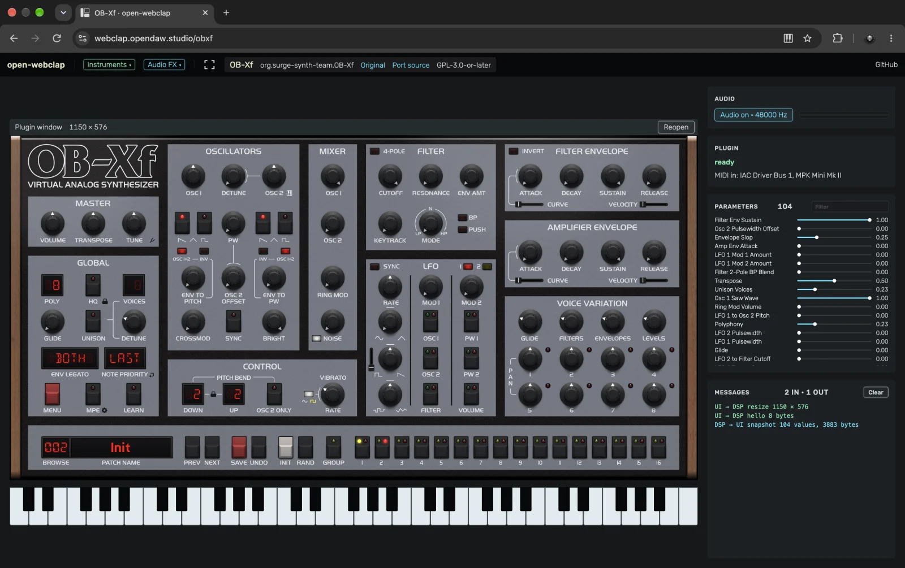

# open-webclap

Open-source audio plugins ported to WebCLAP, the CLAP plugin format for the browser.

**Try them at [webclap.opendaw.studio](https://webclap.opendaw.studio/)**: every plugin has a page that runs it in
openDAW's engine, with its own window, notes from the keyboard or a MIDI keyboard for instruments, and the
microphone, an audio file or a test signal for effects. The site is built on the
[openDAW SDK](https://www.npmjs.com/package/@opendaw/studio-sdk), the toolchain behind
[openDAW Studio](https://opendaw.studio), and the same
bundles are in the studio's WebCLAP catalog.

[](https://webclap.opendaw.studio/)

A WebCLAP bundle is a `module.wasm` (the DSP as a CLAP plugin) and a webview page (the plugin's editor). How a
plugin gets there depends on what it is written with, so the ports here come from different toolchains:

- **JUCE plugins** use the kit in this repository (see [The JUCE kit](#the-juce-kit)): tools and boilerplate that
  turn a `juce::AudioProcessor` into `module.wasm` and run the plugin's unmodified JUCE editor in a browser canvas.
- **Other plugins** bring their own build. Polarity SC Dark is a Rust/NIH-plug plugin built for `wasm32-wasip1`,
  with an HTML/Canvas interface ([port guide](ports/sc-dark/README.md)).

## Plugins

| Plugin | Description | Port | License |
|---|---|---|---|
| [OB-Xf](https://github.com/surge-synthesizer/OB-Xf) | Virtual analog synth after the Oberheim OB-X, the continuation of OB-Xd | JUCE kit: a `juce::AudioProcessor`, wrapped by the kit on both sides | GPL-3.0-or-later |
| [Six Sines](https://github.com/baconpaul/six-sines) | Small phase-modulation synth: six sine-based operators in a modulation matrix | JUCE kit, CLAP-first: the module is Six Sines' own CLAP plugin with a webview bridge, the editor runs against a stand-in engine whose message queues cross over as frames (`ports/six-sines/six_sines_wire.h`) | MIT (GPL-3.0 as built) |
| [RipplerX](https://github.com/tiagolr/ripplerx) | Physically modeled percussion synth: mallet and noise exciters into coupled resonators | JUCE kit: an `AudioProcessor` like OB-Xf, plus a little glue for what its editor does beside parameters: keyboard notes, output meter, polyphony, factory programs (`ports/ripplerx/ui_main.cpp`) | GPL-3.0 |
| [Odin 2](https://github.com/TheWaveWarden/odin2) | Polyphonic semi-modular synth: three oscillators, two filters, modulation matrix, effects | JUCE kit: an `AudioProcessor` whose editor edits the patch's non-parameter trees directly; those cross over as tree properties, patch loads as one frame (`ports/odin2/odin2_frames.h`) | GPL-3.0-or-later |
| [Surge XT](https://github.com/surge-synthesizer/surge) | Hybrid synth: many oscillator, filter and effect types, deep modulation | JUCE kit: an `AudioProcessor` whose editor reaches into the whole engine, so `ui.wasm` runs a second, silent engine as its stand-in. Parameters cross over as usual, patch loads as state, modulation routings as frames (`ports/surge-xt/surge_frames.h`). Without Lua, OSC and MTS-ESP | GPL-3.0-or-later |
| [coopiano](https://github.com/peterc/coopiano) | Physically modelled piano: hammer, strings, soundboard, sympathetic resonance and room, no samples | Plain CLAP, no JUCE: upstream's engine behind a small C++ wrapper (`ports/coopiano/coopiano_clap.cpp`), an HTML editor with openDAW Studio's knobs (`ports/coopiano/ui`). Every note's hammer contact is a nonlinear solve too slow for one audio block, so a patch makes it resumable (same results) and the wrapper fills the strike cache in slices on the audio thread | MIT |
| [Polarity SC Dark](https://github.com/polarity/plugin.nih.polarity-sc-dark) | Spectral compressor with upward and downward compression | Rust/NIH-plug + WASI, with a separate HTML/Canvas interface, presets, draggable curve points, and help ([port guide](ports/sc-dark/README.md)) | GPL-3.0-or-later |

The license column is the plugin's and its port's (`ports/<port>/`). JUCE-built bundles link JUCE, so they ship as
AGPL-3.0. SC Dark and coopiano do not link JUCE: SC Dark uses GPL-3.0-or-later, coopiano MIT. See
[Licenses](#licenses).

## The site

`site/` is [webclap.opendaw.studio](https://webclap.opendaw.studio/), built with Vite, openDAW's JSX library and the
openDAW SDK. Each plugin gets a page at `/<id>` that runs the bundle openDAW hosts in openDAW's engine: its window as
in the studio, the parameters, the frames between page and DSP, and a presentation mode. Pushes to `main` that touch
`site/` deploy it to GitHub Pages; the bundles are not part of the site.

```sh
cd site && npm install && npm run dev  # http://localhost:8130/, ?local loads build/<port>/*.wclap.tar.gz instead
npm run build                          # dist/
```

## The JUCE kit

`modules/juce_webclap` is what JUCE ports are built with. See [PLAN.md](PLAN.md) for the design and the findings of
the existing ports.

- **DSP side:** any `juce::AudioProcessor` as a CLAP plugin in `module.wasm` (`juce_webclap_clap.h/.cpp`), kept free
  of Emscripten imports so any WebCLAP host can load it.
- **Editor side:** the plugin's unmodified JUCE editor as `ui.wasm` in a worker, drawn to an OffscreenCanvas
  (`native/`, `js/webclap-ui.js`), talking to the DSP over the message frames of `juce_webclap_protocol.h`.
- **JUCE for wasm:** `juce_webclap.cmake` and small JUCE changes (`patches/juce-8-wasm.patch`).

Shared by every port, JUCE or not:

- **A test host** (`test-host/`): a page that runs a bundle in an AudioWorklet and shows its editor, for testing a
  port without a DAW.
- **A WASI shim** (`modules/webclap/wasi_shim.cpp`): keeps an Emscripten-built `module.wasm` free of "env" imports
  (an empty read-only filesystem, the memory growth hook, entropy from WASI), so it imports WASI only.
- **Scripts:** `fetch-deps.py` (pinned sources, patched), `build-<port>.sh`, `bundle-license.sh`, `pack-wclap.py`.

## Build and run

JUCE ports need Emscripten (emsdk, tested with 3.1.51), CMake, Python 3.

```sh
scripts/build-obxf.sh                 # fetches pinned deps into external/, patches JUCE, builds
python3 scripts/serve.py build/obxf/web
open http://127.0.0.1:8123/

scripts/build-six-sines.sh            # the same for Six Sines
python3 scripts/serve.py build/six-sines/web 8124
open http://127.0.0.1:8124/

scripts/build-ripplerx.sh             # and RipplerX
python3 scripts/serve.py build/ripplerx/web 8125
open http://127.0.0.1:8125/

scripts/build-odin2.sh                # and Odin 2
python3 scripts/serve.py build/odin2/web 8126
open http://127.0.0.1:8126/

scripts/build-surge-xt.sh             # and Surge XT
python3 scripts/serve.py build/surge-xt/web 8127
open http://127.0.0.1:8127/

scripts/build-coopiano.sh             # and coopiano (no JUCE: a few seconds)
python3 scripts/serve.py build/coopiano/web 8129
open http://127.0.0.1:8129/
```

A clean OB-Xf build takes about 12 minutes, mostly the large JUCE unity files. `-DOBXF_WEB_PNG_THEME=OFF` (passed to
the build script) drops the 9 MB bitmap theme and keeps only OB-Xf's embedded vector theme.

The bundle lands in `build/<port>/web/<port>.wclap` (`module.wasm`, `ui/`), the test host next to it, the archive
hosts import in `build/<port>/<port>.wclap.tar.gz`. Any port's bundle opens with `?bundle=<dir>`.

SC Dark needs Rust stable with `wasm32-wasip1` and `rust-docs`, Node 23 or later, Python 3, Git, and tar. Run
`scripts/build-sc-dark.sh --test`; the import archive is `build/sc-dark/polarity-sc-dark.wclap.tar.gz`. It does not
use the JUCE test host: try a build on the site with `?local` (`/sc-dark?local` in dev), or as an audio effect in
openDAW. See [ports/sc-dark/DEVELOPMENT.md](ports/sc-dark/DEVELOPMENT.md).

## Using the test host

- **Start audio** (browsers need a click), then play notes on the on-screen keyboard, the computer keys
  A W S E D F T G Y H U J K (Z/X change octave) or a MIDI keyboard.
- Turn knobs in the editor. The log shows the page's `gesture` begin, `param` values (at most one per parameter
  per frame) and `gesture` end, then the same as CLAP output events the host received.
- Editors larger than the space scroll in the plugin window. The wheel scrolls it over the editor's background;
  over a knob it turns the knob (the page passes on wheel events no control used, see `js/webclap-ui.js`).
- **Automate** moves a parameter from the host side at 30 Hz. The editor's knob follows, nothing echoes back.
  The parameter sliders in the side panel send single values the same way.
- BROWSE, PREV/NEXT load factory patches (packaged with the page at `/factory`). The editor sends the changed
  parameters and the new state blob, the sound changes.
- **Reopen** destroys and recreates the plugin window. The page says `hello`, the DSP answers with a snapshot
  (values + state) and the editor comes back on the same patch.
- **Save state / Load state** is `clap.state`. Load sends the editor a snapshot.
- **Host calls on_main_thread** off behaves like a host that ignores `request_callback`: the plugin then sends
  page updates from `process()`.
- MENU → Zoom resizes the editor. It sends `resize`, the plugin asks the host with `request_resize`.

## Contributing

New ports are welcome, from any toolchain. A good candidate is open source, can do without threads (hosts like
openDAW run plugins single-threaded: no `std::thread`, no wasm threads) and draws its editor in software or as a web
page. Each plugin gets its own folder, `ports/<port>/`, named in lower case with dashes, a row in the table above
and an entry in `site/src/plugins.ts`.

**JUCE plugins** use the kit. The license must allow the combination with JUCE's AGPL-3.0 (GPL-3.0, MIT, BSD, ...)
and the editor must not need an `OpenGLContext`. The files around a JUCE port:

- `ports/<port>/CMakeLists.txt` builds both modules, `dsp_main.cpp` the DSP (`module.wasm`), `ui_main.cpp` the
  editor (`ui.wasm`), `ui/index.html` the bundle's page. Start from the port closest to yours: `ports/obxf` for a
  plain `AudioProcessor`, `ports/ripplerx` or `ports/odin2` when the editor does more than parameters,
  `ports/six-sines` for a CLAP-first plugin.
- `ports/<port>/NOTICES.md.in` lists every component in the bundle with copyright and license, and
  `ports/<port>/LICENSE` holds the plugin's license when it is not MIT.
- The plugin's source is not checked in. Add it, pinned to a commit, with its submodules to `DEPS` in
  `scripts/fetch-deps.py`, with a filter that fetches only what the build needs.
- Changes to the plugin's source go in `patches/<port>-*.patch` (add the prefix to `PATCH_TARGETS`). Keep them
  small and describe each at the top of the file; prefer hooks the port fills in over rewrites.
- `scripts/build-<port>.sh` builds the bundle, copies the page and test host, bundles the licenses and packs the
  archive, like the existing ones. Add its commands under [Build and run](#build-and-run), with the next free port
  for `serve.py`.

Before opening a pull request, run a clean build (`rm -rf build/<port>`) and check in the test host that notes
play, the editor's controls move the sound, automation moves the controls, and state survives Save/Load state and
Reopen. Changes to `modules/juce_webclap` touch every port: build them all.

**Other plugins** bring an independent build path that keeps its dependencies pinned and ships its own license and
notices. coopiano is the smallest: a plain CLAP plugin in C++ (`ports/coopiano`), built with Emscripten and the
kit's WASI shim, no JUCE. SC Dark shows another: `ports/sc-dark/upstream.json` pins the source, a patch and an overlay adapt it, and
`scripts/build-sc-dark.sh` builds, tests and packs the bundle.

## Licenses

The kit, scripts, site and docs are MIT ([LICENSE](LICENSE)), except the SC Dark port and its build wrapper, which
use GPL-3.0-or-later ([ports/sc-dark/LICENSE](ports/sc-dark/LICENSE)). SC Dark does not link JUCE. Each port keeps
its plugin's license (see the table above, and `ports/<port>/LICENSE` for the GPL ports).
`patches/juce-8-wasm.patch` modifies JUCE and falls under JUCE's license, the other patches under their plugin's
license.

Each JUCE bundle ships its license (`LICENSE`, AGPL-3.0; coopiano's is MIT), `NOTICES.md` (components, copyrights, the repository commit
it was built from) and the longer texts in `licenses/`, see `ports/<port>/NOTICES.md.in` and
`scripts/bundle-license.sh`. Build hosted bundles from a clean, pushed commit, so the source link matches.

JUCE-built bundles link JUCE, so they are AGPLv3 (or covered by a commercial JUCE license) and also under the port's
license. JUCE is AGPLv3/commercial, OB-Xf is GPL-3.0-or-later, RipplerX GPL-3.0, Odin 2 GPL-3.0-or-later (its Aldrich
font OFL-1.1), Surge XT GPL-3.0-or-later, Six Sines MIT (GPL-3.0 as built), coopiano MIT, the CLAP headers MIT, the DejaVu fonts
under the Bitstream Vera license; none of them is checked in, `scripts/fetch-deps.py` downloads them.
